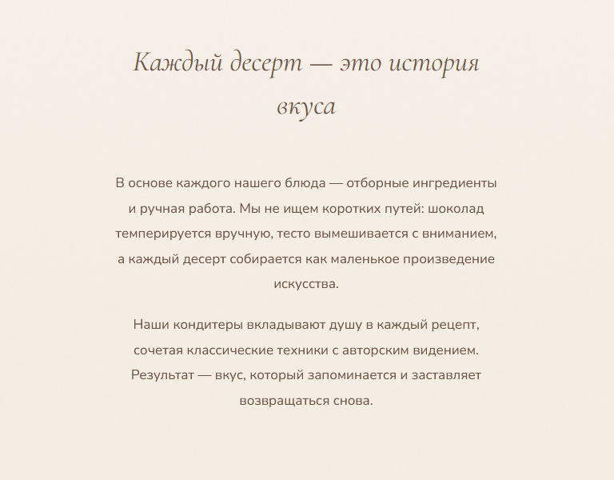

# melty

## Melty Cafe Color Palette:
🟤 Dark Chocolate Brown (~#5C3D2E) — Their primary brand color. The logo is white script on a rich dark brown circle. This is the anchor of the whole identity.
🟤 Warm Coffee/Caramel Brown (~#8B6544) — Dominates throughout the feed in coffee drinks, wooden serving boards, and the warm ambient lighting of the interior.
🟡 Warm Amber/Golden (~#C9994A) — The cozy golden glow from string lights and warm cafe lighting that appears in almost every post, giving everything a candlelit feel.
⚪ Cream/Beige (~#F0E6D6) — Their branded cups and packaging are a soft matte cream tone. Also shows up in plates, food presentation, and text overlays.
⬜ White (~#FFFFFF) — Used for the "Melty" logo script, text overlays on posts, and as accents against dark backgrounds.
🔴 Deep Burgundy/Maroon (~#7B2D3B) — A subtle accent color visible in some highlight covers and occasional food elements (strawberries, sauces).
Overall vibe: The site uses a warm, light luxury aesthetic — cream and beige backgrounds with rich dark chocolate text and accents. Think upscale artisanal cafe: airy, elegant, and inviting. The palette leans into warm tones (cream, caramel, gold) with dark brown as the text/accent color, not as backgrounds. The bio uses a brown heart 🤎. Everything communicates warmth, chocolate, and comfort — which aligns perfectly with their tagline "Мир вкуса и уюта" (World of taste and comfort).

